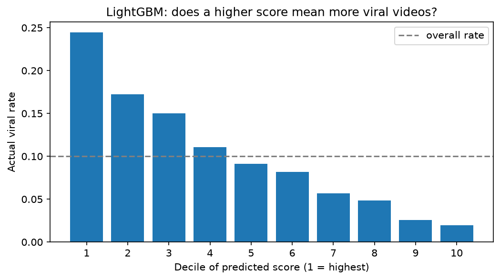

# Predicting viral TikTok videos from posting-time information

Can a video's success be anticipated using only what is known when it is posted? This project
defines "viral" as being in the **top 10% of views within the video's posting month**, then trains
models on 60,000 videos sampled from 2025 to 2026. A gradient boosting model (LightGBM) ranks videos
about **twice as well as chance** (PR-AUC 0.214 vs 0.10 on a held-out 2026 test set) and the result
holds on an independent 2024 sample. The signal is modest because the data contains no information
about the creator (followers, past performance).

## Key results

| Dataset | Period | Random baseline | PR-AUC | Ratio vs random | Recall in top 10% |
|---|---|---|---|---|---|
| Validation | Sep 2025 to Jan 2026 | 0.100 | 0.204 | 2.04 | 0.244 |
| Test | Jan to Jun 2026 | 0.101 | 0.214 (95% CI 0.201 to 0.231) | 2.12 | 0.248 |
| 2024 sample (out of time) | Jan to Dec 2024 | 0.100 | 0.229 | 2.28 (95% CI 2.20 to 2.37) | 0.272 |

- A logistic regression baseline reaches a validation PR-AUC of 0.172, below LightGBM (0.204).
- Ranking videos by predicted score, the top decile contains about 24% viral videos and the bottom
  decile about 2% (validation), against 10% on average. The model is useful both to find likely
  viral videos and to rule out unlikely ones.



## Problem and definition of "viral"

- **Task:** binary classification, `is_viral` = 1 if the video's views are in the top 10% of all
  videos posted in the same calendar month.
- **Why a relative threshold:** views are heavy-tailed and the number of views needed to be in the
  top 10% changes from month to month. A fixed threshold would label mostly recent videos as viral.
- **Metrics:** PR-AUC (compared with the random baseline, which equals the positive rate of about
  0.10), ROC-AUC, and recall in the top 10% of ranked videos. Accuracy is not used because of
  class imbalance.

## Data

- **Source:** [datasocial/tiktok-5.6B-videos](https://huggingface.co/datasets/datasocial/tiktok-5.6B-videos)
  on Hugging Face (5.6 billion videos, 460 GB, one Parquet file per month).
- **Sample used:** 59,994 videos from January 2025 to June 2026 (18 months, about 3,300 random
  videos per month, spread over 546 distinct days). The period stops at June 2026 so every video had
  at least 4 months to collect views.
- **Out-of-time sample:** 60,000 videos from 2024, never used for training or tuning.
- **Split:** chronological, to mimic predicting the future from the past.

| Split | Rows | Period |
|---|---|---|
| Train | 27,597 | Jan 2025 to early Sep 2025 |
| Validation | 14,398 | Sep 2025 to Jan 2026 |
| Test | 17,999 | Jan to Jun 2026 |

## Method

| Stage | Notebook |
|---|---|
| Sampling the data without downloading 460 GB | `01c_sample_2025_2026` |
| Chronological split | `02_split` |
| Definition of "viral" (three candidate labels compared) | `03_define_viral` |
| Exploratory analysis of the training set | `03b_eda` |
| Feature engineering | `04_features` |
| Baseline models, evaluation, uncertainty, final test | `05_baseline` |
| Experiment: caption text features | `06_text_features` |
| Robustness to the viral definition | `07_robustness` |
| Out-of-time check on 2024 | `08_out_of_time` |

**Features (known at posting time only):** hour and weekday of posting, country (10 largest, others
grouped), language, type (video or photo), duration, caption length, number of hashtags, mentions
and on-screen text blocks, ad and shop flags, and sound popularity.

**Leakage controls**
- Excluded because they define or reveal the label: views, likes, comments, shares, saves,
  downloads, engagement rate.
- Excluded because they are decided after posting: `not_recommended_for_fyp`, `sound_muted`.
- Everything learned from data (country list, sound popularity) is computed on the training set only.
- The test set was scored once, after the model and features were fixed.

## Findings

- **Caption length** is the most used feature (about 35% of the model's gain), followed by
  **duration** (about 20%), number of hashtags, posting hour and language.
- The viral rate rises from about 4% for very short captions to about 17% for long ones, and
  from about 5% with no hashtag to about 18% with 8 or more.
- Hashtags still add information inside each caption-length band, but less than the raw
  numbers suggest, because caption length and hashtags overlap (Spearman correlation 0.82).
- Duration is not linear: the longest videos have the highest viral rate and the shortest the lowest.
- Videos with unknown language are rarely viral, but half of them have an empty caption, so this
  mostly reflects the missing text.
- Day of the week carries almost no signal.
- **Caption words did not help:** adding a compressed TF-IDF representation lowered validation
  PR-AUC from 0.204 to 0.198 (paired gain -0.005, 95% CI -0.015 to 0.005), so it was rejected.
- **A stricter label (top 5%)** gives a ratio of 2.3 vs random and the same top features, so the
  conclusions do not depend on the 10% choice.
- **Out of time:** performance on 2024 is as good as on 2025 to 2026, and stays above a ratio of 2.0
  in each of the 12 months.

These are associations, not causes. The results do not show that writing longer captions or adding
hashtags makes a video viral.

## Limitations

- No creator information (followers, past performance), usually the strongest driver of virality,
  so the signal is modest.
- Validation was used for early stopping, so validation scores are slightly optimistic.
- Two split boundaries fall in the middle of a month, so two monthly thresholds were computed on
  data shared by two splits.
- The 2024 sample was drawn from only 3 blocks of the monthly files, so it may cover fewer days per month.
- The data composition changes across periods (share of US videos, share of photos), and I did not
  check whether this reflects the platform or the sampling.
- The 2024 check is backward in time. It shows stable relationships, not forecasting ability.
- Caption features overlap, so their individual importance should not be read separately.

## Repository structure

```
notebooks/        analysis notebooks, numbered in order (archive/ holds early exploration)
reports/          saved tables and figures
requirements.txt  Python packages
```

The `data/` folder is not included. It is created by the notebooks.

## How to reproduce

1. Install Python 3.10 or later (developed with 3.13), then:
   ```
   python -m venv .venv
   .venv\Scripts\activate
   pip install -r requirements.txt
   ```
2. Create the folders `data/raw`, `data/processed`, `data/sample_recent` and `reports`.
3. Run the notebooks in the order of the Method table. Sampling (`01c`) reads random blocks of the
   Hugging Face files and takes a while (about 30 minutes or more). The 2024 sample was produced by
   `notebooks/archive/01b_sample_recent.ipynb`.

## Data license and attribution

The dataset is distributed under **CC BY-NC 4.0** (non-commercial use, attribution required).
Source: https://huggingface.co/datasets/datasocial/tiktok-5.6B-videos. This repository contains no
raw data.

## Author

Ahmed Chelaifa